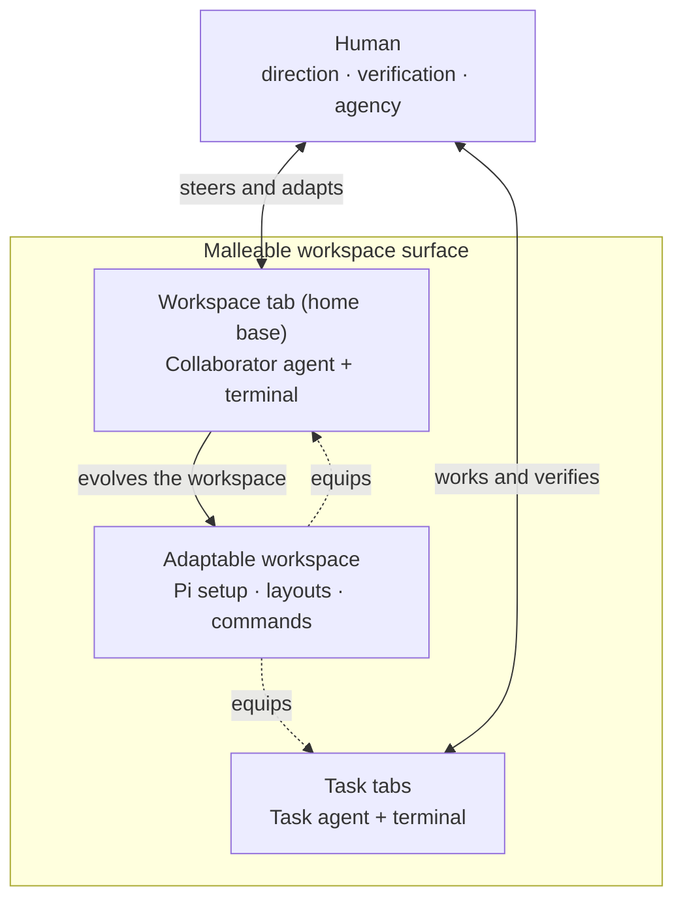

# Agent Workspace

My malleable agent setup. Self-contained workspace for Pi and Zellij configuration.

## Contents

- `pi/` — Pi agent directory and global instructions.
- `zellij/` — Zellij config, layouts, and helper scripts.
- `bin/` — workspace CLI commands, currently `bench`.
- `launch-agent` — sets the workspace environment and starts the `Agent` layout.

[`mise.toml`](mise.toml) defines the pinned tool versions. On a fresh checkout, run `mise trust` and `mise install`, then start the workspace with `./launch-agent`.

## Commands

Use `bench edit [file]` to open a file in a floating pane; it interprets `EDITOR` as a shell command and defaults to `vim`. With no file argument, it opens an `fzf` picker with a `bat` preview; `ripgrep` supplies candidates while respecting ignore rules. The command is available in panes launched with `./launch-agent`.

## Philosophy

To understand why this tool exists and the principles behind it, see [`PHILOSOPHY.md`](./PHILOSOPHY.md).

## Architecture

For more detail, see [`ARCHITECTURE.md`](ARCHITECTURE.md). Component-specific details are documented alongside their configuration in [`pi/`](pi/README.md) and [`zellij/`](zellij/README.md).

Use Conventional Commits; see `CONTRIBUTING.md`. Enable the included template in this clone with `git config --local commit.template "$PWD/.gitmessage"`.
