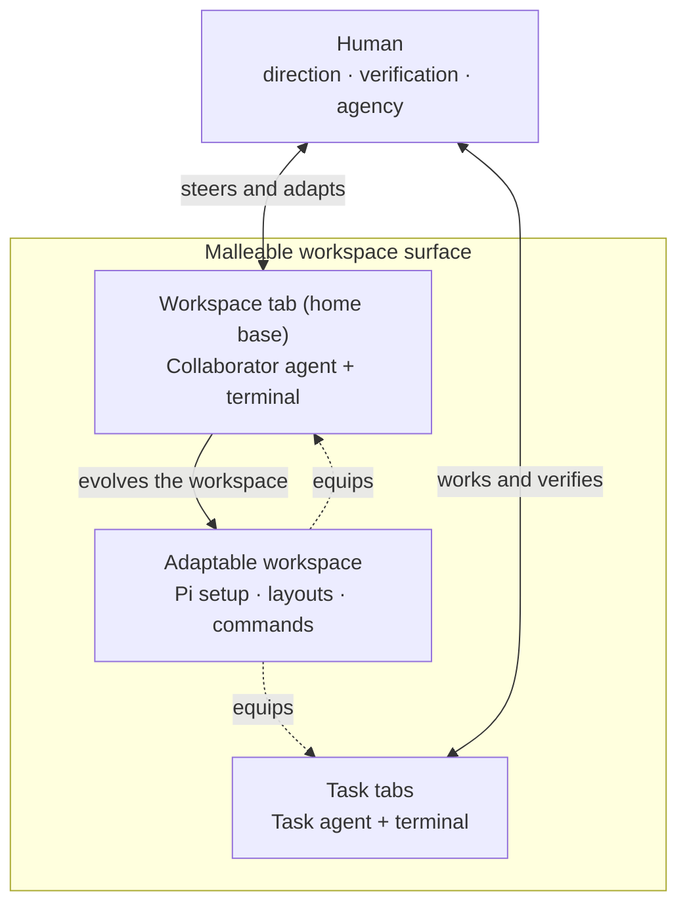

# Agent Workspace

My malleable agent setup. Self-contained workspace for Pi and Zellij configuration.

## Get started

[`mise.toml`](mise.toml) pins the tool versions. On a fresh checkout, run `mise trust`, then `mise install`, and start the workspace with `./launch-agent`.

## Workspace map

- `pi/` — Pi agent directory, instructions, settings, and extensions.
- `zellij/` — Zellij configuration, layouts, and helper scripts.
- `bin/` — workspace CLI commands, currently `bench`.
- `launch-agent` — sets the workspace environment and starts the `Agent` layout.

## Commands

Use `bench edit [file]` to open a file in a floating pane; it interprets `EDITOR` as a shell command and defaults to `vim`. With no file argument, it opens an `fzf` picker with a `bat` preview; `ripgrep` supplies candidates while respecting ignore rules. The command is available in panes launched with `./launch-agent`.

## Customize

Use the task-oriented [customization guides](docs/guides/) to adapt the workspace and see how changes take effect.

## How it works

The diagram connects the workspace's human-centered principles with its structure. [`PHILOSOPHY.md`](PHILOSOPHY.md) explains the principles; [`ARCHITECTURE.md`](ARCHITECTURE.md) covers the technical setup. For component details, see [`pi/`](pi/README.md) and [`zellij/`](zellij/README.md).

Use Conventional Commits; see `CONTRIBUTING.md`. Enable the included template in this clone with `git config --local commit.template "$PWD/.gitmessage"`.
