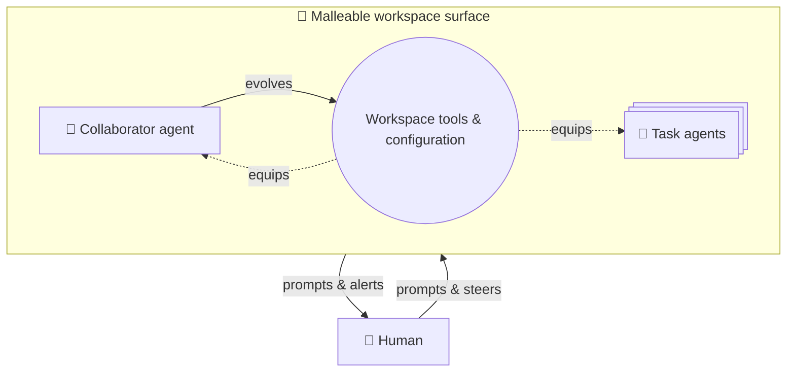

# Agent Workspace

My malleable workspace for human+agent collaboration.

Read [`PHILOSOPHY.md`](./PHILOSOPHY.md) for the rationale; [`ARCHITECTURE.md`](./ARCHITECTURE.md) covers the technical setup.

## Demo

More demos in [`docs/demos`](./docs/demos/README.md).

## Get started

[`mise.toml`](./mise.toml) pins the tool versions. To use those pinned versions, run `mise trust` and `mise install`, then start the workspace with `./agent-workspace`. If you don't want to use `mise`, the launcher falls back to commands available on your `PATH`.

## Workspace map

- [`pi/`](./pi/README.md) — Pi agent directory, instructions, settings, and extensions.
- [`zellij/`](./zellij/README.md) — Zellij configuration, layouts, and helper scripts.
- `bin/` — workspace CLI tools; see the command reference below.
- `agent-workspace` — sets the workspace environment and starts the `Agent` layout.

## Commands

| Command | Description |
| --- | --- |
| `bench` | Pick a command interactively, or list commands when no interactive terminal is available. |
| `bench --help` | List commands and their descriptions. |
| `bench edit [file]` | Open a file in a floating pane, or pick one with `fzf` when no file is given. |
| `bench diff` | Review a Git diff in a floating pane using your configured pager. |
| `bench diff --delta-tui` | Use Delta's TUI for this diff, with files folded initially. |

Commands are executable files in [`bin/bench-commands/`](./bin/bench-commands/). Add an executable file there to add a command; names start with a letter or digit and use only letters, numbers, `_`, or `-`. Put a one-line `# bench-description: ...` comment on the second line (after the shebang) so the picker and help output can explain the command. The dispatcher passes arguments, standard streams, and exit status through.

See the [Git tools guide](./docs/guides/git-tools.md) for pager configuration and Delta theme details.

## Customize

To change the agent harness (defaults to `pi`), set `$AGENT` to choose the agent command; it may include whitespace-separated arguments (for example, `AGENT='my-agent --resume' ./agent-workspace`). It is not evaluated as shell syntax; use a wrapper script if your agent needs complex arguments. Pi-specific configuration under `pi/` is only used by Pi; another agent can use its own configuration.

For more advanced customizations, use the task-oriented [customization guides](./docs/guides/).

